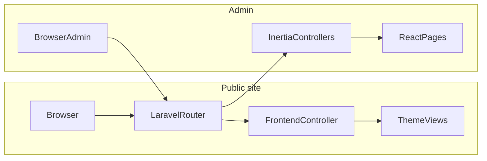

# Overview

**New to NebulaCMS?** Read **[Start here](start-here.md)** first — it points you to installation, everyday admin help, or developer topics depending on your role.

NebulaCMS is an open-source content management system built with **Laravel 12**, a **React + TypeScript** admin (via **Inertia.js**), and a **Blade-based** public site driven by **themes**.

## Major components

1. **Admin panel** (`/admin/*`) — SPA-style UI with Inertia, Radix/Shadcn, Tailwind. Authenticated users manage posts, pages, media, users, roles, themes, plugins, menus, and settings.
2. **Public frontend** — Rendered with the **active theme** under `themes/{folder}/views`. Views use the `theme::` namespace registered in `App\Providers\ThemeServiceProvider`.
3. **Hooks** — **Actions** and **filters** via `HookService` (a conventional hook pattern) so themes and plugins extend behavior without editing core files.
4. **Plugins** — PHP packages under `plugins/{slug}/` with a `plugin.json` manifest, an entry file (e.g. `index.php`), and since **v1.7.0** optional pre-built Inertia admin bundles for shared-hosting-friendly delivery.

## High-level request flow

- **Guest** requests hit `routes/web.php` → `FrontendController` (or feed/sitemap) → Blade views from the active theme.
- **Staff** requests to `/admin` use `routes/admin.php` with `auth` + `verified` middleware → Inertia responses → React pages.

## Tech stack (summary)

| Layer | Technology |
|-------|------------|
| Backend | PHP 8.3+, Laravel 12 |
| Admin UI | React 19, TypeScript, Inertia, Tailwind |
| Public UI | Blade, theme CSS/JS |
| Database | MySQL / PostgreSQL (Eloquent) |
| Auth | Laravel auth, email verification, optional 2FA (TOTP) |
| Permissions | Spatie Laravel Permission (roles & permissions) |

## Further reading

- [About NebulaCMS](about-nebulacms.md)
- [Start here](start-here.md)
- [Installation](installation.md)
- [Admin basics](admin-basics.md)
- [Admin reference](admin-reference.md)
- [Plugin development](plugin-development.md)
- [Theme system](theme-system.md)
