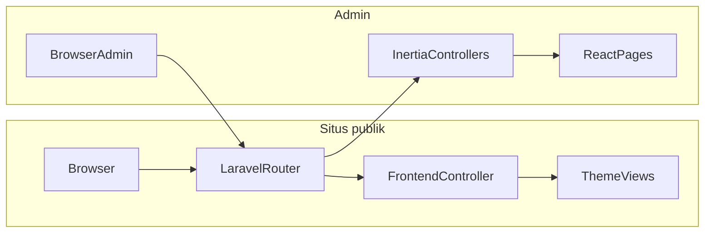

# Gambaran umum

**Baru mengenal NebulaCMS?** Mulai dari **[Mulai dari sini](start-here.md)** agar Anda langsung diarahkan ke jalur yang sesuai: instalasi, operasional admin, atau pengembangan.

NebulaCMS adalah sistem manajemen konten open source yang dibangun dengan **Laravel 12**, panel admin **React + TypeScript** (via **Inertia.js**), dan frontend publik berbasis **Blade** yang digerakkan oleh **tema**.

## Komponen utama

1. **Panel admin** (`/admin/*`) — UI bergaya SPA dengan Inertia, Radix/Shadcn, dan Tailwind. Pengguna terautentikasi dapat mengelola post, page, media, user, role, theme, plugin, menu, dan settings.
2. **Frontend publik** — Dirender oleh **tema aktif** di `themes/{folder}/views`. View menggunakan namespace `theme::` yang diregistrasi di `App\Providers\ThemeServiceProvider`.
3. **Hooks** — **actions** dan **filters** melalui `HookService` agar tema/plugin dapat memperluas perilaku tanpa memodifikasi core.
4. **Plugin** — Paket PHP di `plugins/{slug}/` dengan manifest `plugin.json` dan entry file (misalnya `index.php`).

## Alur permintaan tingkat tinggi

- Request **guest** masuk ke `routes/web.php` -> `FrontendController` (atau feed/sitemap) -> view Blade tema aktif.
- Request **staff** ke `/admin` menggunakan `routes/admin.php` dengan middleware `auth` + `verified` -> response Inertia -> halaman React.

## Stack teknologi (ringkasan)

| Lapisan | Teknologi |
|-------|------------|
| Backend | PHP 8.3+, Laravel 12 |
| UI Admin | React 19, TypeScript, Inertia, Tailwind |
| UI Publik | Blade, CSS/JS tema |
| Database | MySQL / PostgreSQL (Eloquent) |
| Autentikasi | Autentikasi Laravel, verifikasi email, 2FA opsional (TOTP) |
| Otorisasi | Spatie Laravel Permission (roles & permissions) |

## Bacaan lebih lanjut

- [Tentang NebulaCMS](about-nebulacms.md)
- [Mulai dari sini](start-here.md)
- [Instalasi](installation.md)
- [Dasar-dasar admin](admin-basics.md)
- [Referensi admin](admin-reference.md)
- [Sistem tema](theme-system.md)
